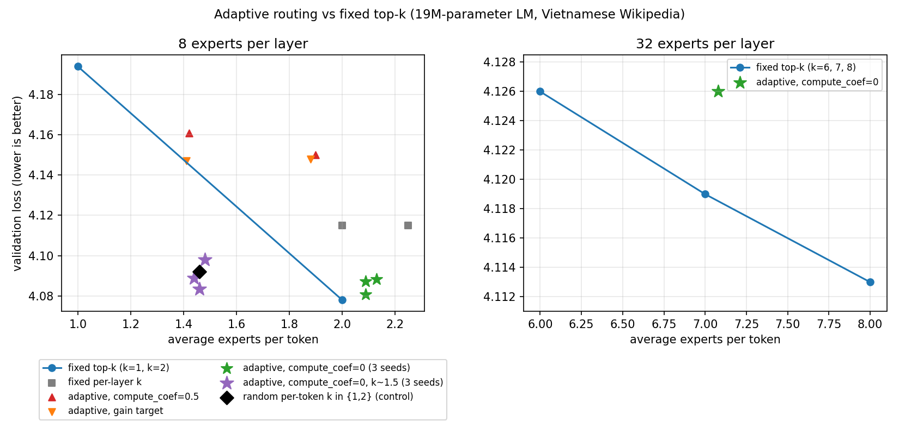

# adaptive-moe


**English** | [Tiếng Việt](README.vi.md)

A small (experimental) PyTorch module for **adaptive** Mixture-of-Experts: the number of experts activated per token, and how strongly each one contributes, change with token difficulty instead of being fixed at top-6 or top-12.

Anyone training an MoE model can swap their MoE layer for `AdaptiveMoE`.

> **Status: experimental.** The mechanism works (the router learns token difficulty and uses more experts on harder tokens), but it does not beat simple baselines: adaptive routing was slightly worse than fixed top-k at equal budget in most settings, and in a low-budget setting it only matched a random per-token choice of k at the same average budget. See [Experimental results](#experimental-results).
>
> What did work is **elastic training**: train with a random k (and/or a random context window) and the same model can then run at any budget, with no loss when data is plentiful and a clear gain in a low-data setting. See [Elastic training](#elastic-training-one-model-many-budgets).

## Install

```bash
pip install git+https://github.com/BachDaThan/Adaptive-MoE
```

or copy `adaptive_moe.py` into your project (PyTorch is the only dependency).

## Components

| Component | What it does |
|---|---|
| `AdaptiveRouter` | Top-p routing: take experts by descending probability until their sum reaches `top_p`. Easy tokens use fewer experts, hard tokens use more. |
| Strength head | Each token gets a learned "strength" factor in `[min_strength, 1]` that scales the contribution of the chosen experts. |
| `target_k` | Pulls the average number of experts toward a value you choose (e.g. 3.0). |
| `n_shared` | Always-on shared experts (DeepSeek style); keeps quality stable when the router picks a single expert. |
| Auxiliary losses | Load balancing, compute penalty, z-loss. Collect them with `gather_aux_loss(model)`. |
| `moe_stats(model)` | Per-layer `avg_k` and `avg_strength` after each forward pass. |
| `diff_head` (experimental) | The router gets a head that predicts token difficulty and sets `top_p` per token. See the results below. |
| `cascade_forward` | Inference: run a small tier first (e.g. 2 experts); if confidence is low, escalate to 4, then 8. Confidence: `maxprob` or `entropy`. |
| `adaptive_generate` | Text generation with per-step tier selection. |
| `max_resident` + `release()` | Keep only N experts on the GPU (LRU); `release()` frees more after a reply. |
| `set_k_cap(model, k)` | Caps the experts per token (inference or training). `k` is an int for every token, or an int tensor `[B*S]` for a per-token cap (version 0.3.1). |

## Usage

```python
from adaptive_moe import AdaptiveMoE, gather_aux_loss, moe_stats, adaptive_generate

# inside your model
self.moe = AdaptiveMoE(d_model=512, d_ff=1024, n_experts=16,
                       top_p=0.7, target_k=4.0, n_shared=1)
y, _, _ = self.moe(x)                      # x: [B, S, D]

# training
loss = task_loss + gather_aux_loss(model)
print(moe_stats(model))                    # {"layers.0.moe": {"avg_k": ..., "avg_strength": ...}}

# inference with per-step escalation
ids, ks = adaptive_generate(model, input_ids, max_new_tokens=64,
                            tiers=(2, 4, 8), min_confidence=0.6, confidence="entropy")
```

## Notes

- `release()` and `max_resident` are for inference (eval) only; do not enable them during training.
- `adaptive_generate` has no KV cache (each step re-runs the whole sequence). `elastic_kv.py` shows a KV-cached version (`adaptive_generate_kv`) on a small reference model; real models can follow the same pattern.
- Cascade re-runs the forward pass when a step is hard, so those steps cost extra compute.
- `top_p`, `target_k` and the loss coefficients need tuning for your model and data.
- This is the router/layer only, not a complete model.

## Language-model experiment (Vietnamese text)

```bash
pip install torch datasets
python lm_experiment.py --mode adaptive --target_k 3.0   # adaptive
python lm_experiment.py --mode fixed --k 3               # fixed top-k baseline
python compare.py                                        # table of all r_*.json results
```

The script trains a small LM (syllable-level tokenization of Vietnamese Wikipedia) and prints validation loss, average experts per token, the correlation between per-token expert count and per-token loss, and the expert count per token category (punctuation, numbers, function words, proper nouns, rare words, content words). Report labels are printed in Vietnamese. Use `--text_file` to train on your own text.

Options: `--ste` (let task-loss gradients reach the expert-selection boundary) and `--diff_head` (the router predicts token difficulty, trained on the real token loss, then sets `top_p` per token within `[p_min, p_max]`). `--layer_k 1,2,2,3` sets a fixed k per layer. `--mode random` runs a random per-token k control, and `--no_renorm` keeps raw gate probabilities (Switch style) so top-1 routers still get a task gradient.

## Experimental results

Setup: 19M-parameter LM, 4 layers, 8 experts per layer, syllable-level tokenization, Vietnamese Wikipedia (30M characters, about 7.5M tokens), 3000 steps. Fixed k=2 and adaptive with `compute_coef=0` were run with 3 seeds (mean and min–max range); all other configurations used one seed. Lower validation loss is better.

| Configuration | avg_k | val loss |
|---|---|---|
| fixed top-k, k=1 (renormalized weights) | 1.00 | 4.194 |
| fixed top-1, raw gate probabilities (`--no_renorm`) | 1.00 | 4.110 |
| fixed top-2, raw gate probabilities (`--no_renorm`) | 2.00 | 4.083 |
| fixed top-k, k=2 (3 seeds) | 2.00 | **4.078** (4.077–4.080) |
| fixed per-layer k (1,2,2,3) | 2.00 | 4.115 |
| fixed per-layer k (1,2,3,3) | 2.25 | 4.115 |
| adaptive + `diff_head`, `compute_coef=0.5` | 1.90 | 4.150 |
| adaptive + `diff_head`, `diff_target=gain`, `compute_coef=0.5` | 1.88 | 4.148 |
| adaptive + `diff_head`, `compute_coef=0` (3 seeds) | 2.10 | 4.085 (4.081–4.088) |
| adaptive + `diff_head`, `compute_coef=0`, low budget (3 seeds) | 1.46 | 4.090 (4.083–4.098) |
| random per-token k in {1,2}, 46% of tokens get 2 (control, 1 seed) | 1.46 | 4.092 |
| random-k training (50/50), then run at k=1 (`--eval_cascade`) | 1.00 | 4.096 |
| random-k training (50/50), then run at k=2 | 2.00 | 4.082 |
| 32 experts (routed d_ff=128, shared d_ff=512), fixed top-8 | 8.00 | 4.113 |
| 32 experts (routed d_ff=128, shared d_ff=512), adaptive + `diff_head`, `compute_coef=0` | 7.08 | 4.126 |
| 32 experts (same), fixed top-7 | 7.00 | 4.119 |
| 32 experts (same), fixed top-6 | 6.00 | 4.126 |



Points below the fixed top-k line are better at the same budget. The renormalized k=1 point is a weak reference (a single renormalized expert gives the router no task gradient). With raw gate probabilities (`--no_renorm`) fixed k=1 reaches 4.110 (blue square), and the adaptive and random points at k≈1.46 sit within about 0.005 nats of the dashed straight line between that point and fixed k=2, i.e. a plain linear trade-off. The right panel spans only 0.015 nats.

Takeaways:
- The router learns token difficulty (correlation with the true loss around 0.4 to 0.5) and the number of experts rises with difficulty (correlation between k and loss from +0.26 to +0.37).
- **Learned allocation does not beat random allocation at equal budget.** At about 1.46 experts per token (8 experts), adaptive routing with `compute_coef=0` reached 4.090 (3 seeds: 4.083 to 4.098), while a control that gives each token k=1 or k=2 at random with the same average budget reached 4.092 (1 seed). Fixed k=1 with raw gate probabilities (`--no_renorm`) reaches 4.110; the renormalized k=1 baseline (4.194) was handicapped because a single renormalized expert gives the router no task gradient. Against that corrected reference, the adaptive and random points at k≈1.46 lie within about 0.005 nats of the straight line between k=1 (4.110) and k=2 (4.078): a plain linear trade-off of roughly 0.03 nats per routed expert, not a special gain. (With raw gate probabilities at both ends, fixed k=2 gives 4.083, so the reference line runs from 4.110 to 4.083, about 0.027 nats per routed expert; the adaptive and random points sit about 0.005 to 0.007 nats below it, comparable to seed noise.) Escalating tokens by the model's own uncertainty (entropy of a cheap k=1 pass) beat random escalation by only 0.0014 nats at a 50% budget (`--eval_cascade`), and the whole range between all-k=1 and all-k=2 spans just 0.014 nats, so there is almost nothing for a controller to gain. (The "oracle" column in that report is not an achievable ceiling: with hindsight it picks the better of two noisy per-token losses.) At about 2 experts per token (8 experts) and at 32 experts, adaptive routing was slightly worse than fixed top-k at equal budget (about 0.007 nats).
- Finer-grained experts (32 instead of 8, similar total parameters): a first run appeared to favor adaptive routing, but that was an artifact of the shared expert shrinking along with `d_ff`. With the shared expert kept wide (`--d_ff_shared 512`), fixed top-8 (4.113) beats adaptive (4.126), which uses about 11% fewer experts and spreads k widely (4.8 on the easiest quartile to 8.3 on the hardest). The fixed top-7 (4.119) and top-6 (4.126) controls settle it: adaptive at k=7.08 matches fixed top-6 while using more experts, so it loses at equal budget by about 0.007 nats, the same gap seen with 8 experts. The fixed curve is also very flat (about 0.0065 nats per expert between k=6 and k=8), which leaves little headroom for any allocation scheme at this scale. This 32-expert setup is also worse than the 8-expert baseline (4.078) at this short training length.
- A stable observation across seeds: when the router is free, deeper layers ask for more experts (layer 1 about 1.3 to 1.6, layer 4 about 2.7 to 2.8). However, hard-coding k per layer (1,2,2,3) was worse than uniform k, so this is not a ready-made recipe.
- "Hard token" does not mean "token that benefits from more experts": a loss-based label sends more experts to rare words and function words, while content words gain the most from an extra expert. A label based on the loss reduction from adding experts (`gain`) was too noisy for the difficulty head to learn.
- `compute_coef=0.5` acts as a helpful regularizer when data is small and the model overfits (1.9M tokens), but hurts once there is enough data.

Limitations: most configurations have a single seed, the model is small, training is short, and wall-clock speed was not measured (the per-expert loop is not optimized). Results at larger scale may differ.

## Elastic training: one model, many budgets

Summary of what the experiments below show (all small models, short training; most configurations have one to three seeds):

- **Elastic k:** train with a random cap on the number of experts and pick k at inference. With plenty of data one elastic model is within about 0.0015 nats of dedicated fixed-k models; with little data it was clearly better than fixed-k training (section 4).
- **KV cache and context window:** generation with a KV cache matches full recomputation; a sink + sliding-window context bounds the cache at `sink + W` tokens at almost no loss (sections 2 and 3).
- **Smarter allocation of k does not beat a single fixed k at equal average cost.** Small effects exist only in the cost range between k=1 and k=2 (section 5). A per-layer schedule that looked good on an elastic model **did not hold up** when trained from scratch (section 5.3).

Run-to-run noise on the same seed (GPU nondeterminism) was about 0.002-0.003 nats, so only compare cells within one table or run.

### Scripts

| Script | What it does |
|---|---|
| `elastic_kv.py` | KV-cached generation with the confidence cascade (`adaptive_generate_kv`), plus a self-test. |
| `elastic_ctx.py` | Sink + sliding-window context with a bounded KV cache; `--selftest`, `--train`, `--grid`. |
| `headroom.py` | Token-level estimate of what a per-token k allocator could gain. |
| `tokenk.py` | Per-token k inside the layers (needs `adaptive_moe.py` >= 0.3.1). |
| `layerk.py` | Scans per-layer k schedules on one elastic model. |
| `schedule_train.py` | Trains each k schedule from scratch (the check for `layerk.py`). |
| `run_both.sh`, `run_ctx.sh`, `run_tokenk.sh`, `run_layerk.sh`, `run_schedule.sh` | Run the above end to end. |

```bash
python elastic_ctx.py --selftest
python elastic_ctx.py --grid --top_p 0.999 --hf wikimedia/wikipedia --config 20231101.vi --field text --mb 8
python headroom.py --hf wikimedia/wikipedia --config 20231101.vi --field text --mb 8 --bpe --experts 32 --k_hi 2 --L 128
bash run_tokenk.sh
bash run_schedule.sh 0
```

### 1. Elastic k: train once with random k, choose k at inference

8 experts/layer, 19.3M params, 7.5M-token corpus, 3000 steps (`--mode random --uniform_k --k_lo 1 --k_hi 4 --eval_ks 1,2,3,4`). Validation loss with k forced at inference:

| k | 1 | 2 | 3 | 4 |
|---|---|---|---|---|
| Elastic (trained with k~U{1..4}) | 4.1014 | 4.0765 | 4.0734 | 4.0739 |
| Fixed top-k, trained and run at that k | 4.110\* | 4.078 | 4.0720 | 4.0727 |

\* fixed top-1 with raw gate probabilities (`--no_renorm`). Fixed k=2 is the 3-seed mean; k=3 and k=4 are one seed each.

One elastic model is within about 0.0015 nats of the dedicated fixed-k models at k=2..4, and at k=1 it is not worse than a dedicated top-1 model. Seed-to-seed noise is about 0.002 to 0.004 nats. Training with random k averaged 2.5 experts per token, but evaluating with random k gave 4.082, so forcing a single k at inference is better than leaving k random.

32 experts/layer, 19.4M params, smaller 1.98M-token corpus (so heavily overfit), 3000 steps, train k~U{1..16}:

| k | 1 | 2 | 4 | 8 | 16 |
|---|---|---|---|---|---|
| Elastic, forced k | 4.4088 | 4.3110 | 4.2762 | 4.2628 | 4.2593 |
| Fixed k=4 / k=8 | | | 4.2873 | 4.2908 | |

Here the elastic model beats fixed-k at the same k (by 0.011 at k=4 and 0.028 at k=8). Quality is flat above k=8 and k=1 loses 0.15 nats versus k=8. See section 4 for a cleaner low-data comparison.

### 2. KV cache for generation (`elastic_kv.py`)

Cached incremental decoding matches full recomputation: max logit difference below 1e-6 at k = 1, 2, 4, 8, and greedy generation gives identical ids. With the confidence cascade, old cached tokens keep the k they were computed with, so cascade output is not identical to recomputing the whole sequence at one k (by design).

### 3. Elastic context window (`elastic_ctx.py`)

A token at position $i$ attends to positions $j$ with `j < sink` or `i - j < W` (sink = 4). At inference the KV cache keeps only `sink + W` tokens, and this gives outputs identical to re-running the whole sequence with the same mask (checked by `--selftest`, which also checks that generating 200 tokens at W=16 keeps only 20 cached tokens). Training draws W at random per sample. Setup: byte-level LM, 3.9M params (d=128, 4 layers, 8 experts), sequence length 256, 8 MB Vietnamese Wikipedia (`wikimedia/wikipedia`, `20231101.vi`), 3000 steps, k=2.

Window only, W forced at inference:

| Training | W=8 | 16 | 32 | 64 | 128 | 256 (full) |
|---|---|---|---|---|---|---|
| Full context | 1.2245 | 1.2059 | 1.1962 | 1.1913 | 1.1894 | 1.1890 |
| Random W per sample | 1.2040 | 1.1955 | 1.1904 | 1.1883 | 1.1875 | 1.1876 |

Two runs of this experiment (same seed) agree: random-W training helps most at small W (about 0.02 at W=8, 0.01 at W=16) and costs nothing at full context (difference within 0.0015).

Joint elastic k and W (one model trained with k in {1,2,4,8} and W in {8..256}, `top_p=0.999` so the k cap binds). Each cell is **val loss / decode tok/s** with KV cache. KV tokens kept: 12 / 20 / 36 / 68 / 132 / 256.

| k | W=8 | 16 | 32 | 64 | 128 | 256 |
|---|---|---|---|---|---|---|
| **1** | 1.2215 / 79 | 1.2129 / 82 | 1.2083 / 81 | 1.2069 / 83 | 1.2059 / 81 | 1.2060 / 84 |
| **2** | 1.2099 / 79 | 1.2021 / 79 | 1.1973 / 80 | 1.1955 / 79 | 1.1947 / 78 | 1.1947 / 81 |
| **4** | 1.2091 / 71 | 1.2013 / 74 | 1.1965 / 73 | 1.1947 / 73 | 1.1939 / 73 | 1.1938 / 75 |
| **8** | 1.2092 / 67 | 1.2013 / 68 | 1.1964 / 66 | 1.1946 / 67 | 1.1938 / 66 | 1.1937 / 69 |

- Shrinking the cache from 256 to 68 tokens (W=64) costs about 0.0008 nats; to 36 tokens about 0.0026; to 20 tokens about 0.0074.
- k=1 costs about 0.011 nats versus k=2. k=4 and k=8 gain only about 0.001 over k=2 while decoding about 7% and 15% slower here, so k=2 is the sweet spot for this small model. (With `top_p=0.9` the grid had the same shape; there the cap may not bind for k>=4.)
- At equal cache size, spending budget on k beats spending it on W: (k=2, W=16) is better than (k=1, W=64) with a smaller cache.
- tok/s is dominated by Python overhead at this model size and is only indicative; the batched CUDA benchmark in section 6 is the speed reference.

**Limitations:** one seed per configuration, sequence length 256, small models, byte-level tokens. At this length the model barely uses long context, so the saving is nearly free; nothing is shown yet for long sequences.

### 4. Elastic training vs fixed training in a low-data regime

Setup: BPE vocab 16000 trained on the train split, 1.48M train tokens (8 MB of Vietnamese Wikipedia, split by random line), 32 experts, 4 layers, d=128, sequence 128, batch 32, 3000 steps (about 8 passes over the data), `top_p=0.999` so the cap binds. All numbers are val loss on the same 40 batches (81,920 tokens). Elastic models were trained with a random per-token k in {1,2} (`tokenk.py`); fixed models were trained and run at one k (`schedule_train.py`, one seed).

| Model | k=1 | k=2 | k=4 |
|---|---|---|---|
| Fixed, trained at that k (seed 0) | 4.6575 | 4.7058 | 4.8201 |
| Elastic, forced k at eval (seed 0 / 1 / 2) | 4.6613 / 4.6491 / 4.6463 | 4.6236 / 4.6120 / 4.6122 | not trained |

- With fixed training, more active experts is worse here: k=4 is 0.16 nats worse than k=1. In the elastic runs the last-step training loss was about 3.0 to 3.3 against a validation loss above 4.6, so this regime is data-limited and likely overfit; the training loss of the fixed models was not logged.
- The elastic model at k=2 is 0.08 nats better than fixed k=2 and 0.03 to 0.05 nats better than the best fixed model (k=1).
- Likely explanation (not tested): random k acts like dropout over experts, which helps when data is small. Not yet done: a fixed-k baseline with dropout or early stopping, and fixed-k seeds beyond one. With 7.5M tokens (section 1) the elastic and fixed models were equal within 0.0015 nats.

Practical reading: with limited data, training with random k is a cheap way to get a model that is at least as good as fixed-k training and can be run at any k afterwards.

### 5. Does allocating k smartly beat a fixed k?

Same BPE setup as section 4. Cost is the average number of routed experts per token per layer (shared expert and attention not counted). Because these experiments use elastic-trained models, they measure how an elastic model uses its experts; section 4 shows that in this low-data regime a fixed-trained k=2 model is not better than k=1.

**5.1 Token-level estimate (`headroom.py`).** Train one elastic model, measure every token's loss at k=1 and at a higher k, then pick which tokens get the higher k under a budget (random, entropy of the k=1 output, small MLPs on early or late hidden states, or a token-frequency rule). This is an estimate at the token level and ignores effects through attention.

- k=1 versus k=4 (gain 0.103 nats): at the same average cost a single fixed k beats any allocation between k=1 and k=4. At cost 2, fixed k=2 recovers 83% of the gain versus 33% (random), 38% (entropy) and 44% to 56% (learned predictors). At cost 3, fixed k=3 recovers 97% versus 66% to 84%.
- k=1 versus k=2 (gain 0.063 nats): share of the k=2 gain recovered when a fraction f of tokens gets k=2:

| f | random | entropy | rare | common | learn_emb | learn_l1 | learn_fin |
|---|---|---|---|---|---|---|---|
| 0.1 | 9% | 10% | 19% | 4% | 17% | 16% | 25% |
| 0.25 | 26% | 26% | 36% | 15% | 35% | 38% | 45% |
| 0.5 | 50% | 54% | 64% | 36% | 64% | 65% | 72% |
| 0.75 | 76% | 83% | 85% | 64% | 88% | 86% | 88% |

`rare` (upgrade the rarest token types, a lookup in train token counts) matches a learned predictor on the input embedding (`learn_emb`) at no cost. The entropy rule needs the whole k=1 pass first, so it costs 1 + 2f rather than 1 + f.

**5.2 Per-token rule inside the layers (`tokenk.py`).** A per-token k is passed to every MoE layer (`set_k_cap(model, tensor)`). The model is trained with random per-token k in {1,2}; `rare - random` at the same fraction f of tokens upgraded to k=2 (negative = rare is better, nats). Total k=1 to k=2 gain in these models is 0.034 to 0.042 nats.

| seed | f=0.25 | f=0.5 | f=0.75 |
|---|---|---|---|
| 0 | -0.0061 | -0.0069 | -0.0044 |
| 1 | -0.0075 | -0.0051 | -0.0056 |
| 2 | -0.0043 | -0.0062 | -0.0065 |
| 0, trained with the rare rule | -0.0122 | -0.0101 | -0.0079 |

The opposite rule (upgrade the most common tokens) is worse than random every time (about +0.005 to +0.006), so the effect is not noise. It is small (about 0.006 nats) and only fills the cost range between k=1 and k=2, which fixed top-k cannot reach because k is an integer.

**5.3 Per-layer k: not confirmed by training from scratch.** One elastic model trained with k drawn independently per layer from {1,2,4}, scanning all 81 schedules (`layerk.py`, chosen on validation half A, reported on half B), suggested that early layers do not need a large k. For example schedule (1,1,2,4) beat uniform k=2 by 0.010 to 0.011 nats at the same cost on both seeds. Training each schedule from scratch (`schedule_train.py`, seed 0) does **not** reproduce this:

| k per layer | cost | val loss | train s | vs uniform k=2 |
|---|---|---|---|---|
| (1,1,1,1) | 1.0 | 4.6575 | 283 | -0.0483 |
| (2,2,2,2) | 2.0 | 4.7058 | 289 | 0 |
| (4,4,4,4) | 4.0 | 4.8201 | 327 | +0.1143 |
| (1,1,2,2) | 1.5 | 4.6634 | 286 | -0.0425 |
| (1,1,2,4) | 2.0 | 4.7214 | 294 | +0.0155 |
| (1,1,4,4) | 2.5 | 4.7509 | 296 | +0.0451 |
| (4,2,1,1) | 2.0 | 4.6873 | 306 | -0.0186 |

The schedule that looked best on the elastic model is worse than uniform k=2, and the reversed control (4,2,1,1) is better. What an elastic model does with each layer's experts is not a guide to which schedule to train. A fixed per-layer k was also worse than uniform k in the first experiment above, so per-layer schedules are not recommended.

**Conclusion of this section.** A single fixed k remains the baseline to beat. The effects found are small (about 0.01 nats or less) and limited to costs between k=1 and k=2. The robust result is elastic training itself (sections 1 and 4).

### 6. Measured speed (CUDA, batch 32x128; ratio vs using all experts)

| Experts | k | inference | train |
|---|---|---|---|
| 8 | 1 / 2 / 4 | 0.42x / 0.48x / 0.66x | 0.43x / 0.50x / 0.66x |
| 32 | 1 / 8 / 16 | 0.43x / 0.48x / 0.62x | 0.18x / 0.36x / 0.56x |

Using fewer experts is faster in practice, but not proportionally at inference (32 experts, k=1 is 0.43x, not 1/32). Fixed per-step overhead (attention, embedding, dispatch) dominates at small k. In the 4-layer BPE runs above, wall-clock training time hardly depended on k (283 s at k=1, 289 s at k=2, 327 s at k=4), so compute savings should not be assumed at that size.

## Benchmark

`python bench.py` measures real throughput (tokens per second, inference and training) when every token is forced to use exactly k experts, so you can check whether using fewer experts is actually faster on your hardware. Example: `python bench.py --experts 32 --d_ff 128 --ks 1,4,8,16,32`.

## Tests and demo

```bash
pip install torch pytest
pytest -q                  # or: python test_adaptive_moe.py
python train_demo.py
```

## License

MIT © 2026 BachDaThan, see [LICENSE](LICENSE).
