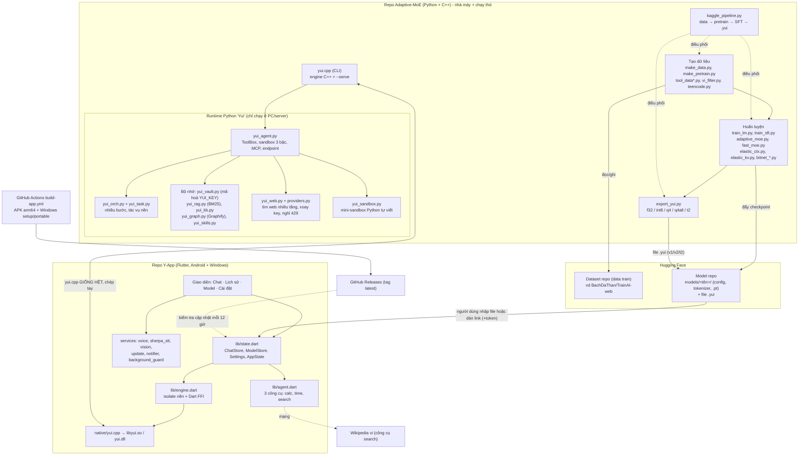
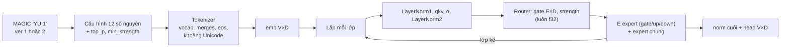
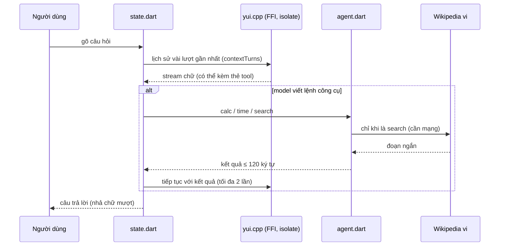

# SƠ ĐỒ HIỆN TẠI — Adaptive-MoE + Y-App

> Chụp ngày 2026-11-12, từ code thật trong 2 repo. Xem sơ đồ trên GitHub (hỗ trợ Mermaid) hoặc dán vào https://mermaid.live.
> Sơ đồ SAU KHI XONG KẾ HOẠCH: xem `SO_DO_SAU_KHI_XONG.md`.

## 1. Bức tranh tổng

## 2. Định dạng `.yui` hiện tại (tuần tự, không có mục lục)

Mỗi ma trận (từ v2) có 1 byte kiểu: 0 f32 · 1 int8 · 2 q4 · 3 t2 (ternary). Không có bảng offset → muốn đọc riêng một expert phải tính tuần tự.

## 3. Luồng một câu hỏi trong Y-App hiện tại

Chạy 100% offline trừ công cụ `search`, tải model từ link và kiểm tra cập nhật.

## 4. Có gì ở đâu (ma trận tính năng)

| Tính năng | Adaptive-MoE (Python) | Y-App (Flutter) |
|---|---|---|
| Engine C++ chạy `.yui` | ✔ (CLI, `--serve`) | ✔ (FFI) |
| `yui.cpp` | bản gốc | **bản sao y hệt** (115 111 byte) |
| Công cụ calc / time / search | ✔ | ✔ |
| Công cụ fetch / read / write / py / MCP | ✔ (sandbox, danh sách cho phép) | ✘ (cố ý) |
| Kho tri thức, RAG, Graphify, skill, vault mã hoá | ✔ | **✘ (không có trong `lib/`)** |
| Làm việc nhiều bước, tác vụ nền | ✔ | ✘ |
| Đoán trước token (speculative) | ✔ trong `yui.cpp` | ✔ (Cài đặt) |
| Hiểu ảnh | ✔ | ✔ |
| Giọng nói (STT offline, TTS) | — | ✔ |
| Tải model từ link HF (+token) | ✔ (script) | ✔ từng file một |
| Danh sách/kho model, manifest | ✘ | ✘ |
| META trong `.yui`, mục lục byte | ✘ | ✘ |
| Cập nhật app | — | ✔ (GitHub Releases) |

## 5. Điểm yếu hiện tại (nguồn gốc của kế hoạch)

1. Muốn đổi model phải tự tìm file/link rồi nhập tay (chưa có kho).
2. `.yui` không tự mô tả (không biết giỏi gì, tương thích gì) và không có mục lục.
3. App không nhớ dài hạn (kho tri thức chỉ có bản Python).
4. `yui.cpp` có 2 bản chép tay → dễ lệch.
5. Ngữ cảnh model nhỏ rất ngắn (L = 128–256 token; kết quả công cụ ≤ 120 ký tự) nên mọi thứ thêm vào prompt phải nén.
