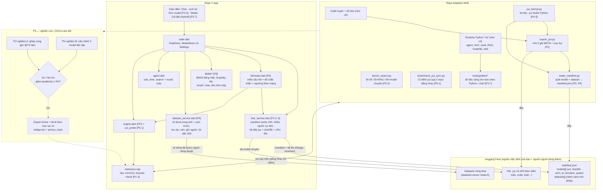
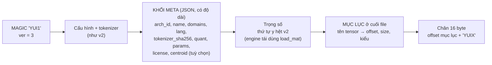
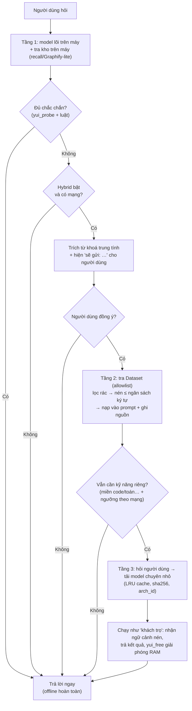

# SƠ ĐỒ SAU KHI XONG KẾ HOẠCH (P0 → P7)

> Đây là **đích**, chưa phải hiện trạng. Nhãn `[P#]` cho biết giai đoạn tạo ra từng phần trong `PLAN.md`.
> Phần P6 (ghép Expert) vẽ nét đứt vì **chưa cam kết**: chỉ làm nếu thí nghiệm đạt tiêu chí Go.
> Sơ đồ hiện tại: `SO_DO_HIEN_TAI.md`. Sau khi xong từng giai đoạn, cập nhật file này cho đúng thực tế (task P7-3).

## 1. Bức tranh tổng sau khi xong



## 2. Định dạng `.yui` v3



- Engine cũ gặp `ver = 3` báo lỗi gọn thay vì chạy sai. Engine mới vẫn đọc v1/v2/t2 như cũ.
- App chỉ cần tải vài KB đầu file (hoặc `manifest.json`) để biết model giỏi gì, không phải tải cả file.
- Mục lục cho phép đọc từng phần khi cần (nền cho P6 nếu Go); ở cấp model thì chưa bắt buộc.

## 3. Luồng một câu hỏi sau khi xong



Rơi về tầng thấp hơn bất cứ khi nào mất mạng, người dùng từ chối, hoặc lỗi.

## 4. Cây thư mục mục tiêu (phần mới)

```text
Adaptive-MoE/
  docs/
    PLAN.md                 # kế hoạch + đánh dấu tiến độ
    SO_DO_HIEN_TAI.md
    SO_DO_SAU_KHI_XONG.md
    YUI_FORMAT.md           # đặc tả v1/v2/t2/v3           [P1-1]
    APP_KB.md               # đặc tả kho trong app         [P3-1]
  tools/check_yui_sync.py                                  [P0-1]
  yui_format.py, test_yui_format.py                        [P0-5]
  make_manifest.py, test_make_manifest.py                  [P2-2]
  bench_swarm.py                                           [P5-5]
  tests/golden/                                            [P3-7]
  exp_merge_same_base.py, exp_align_independent.py         [P6, chưa cam kết]

Y-App/
  tools/check_yui_sync.py                                  [P0-1]
  lib/services/hub_service.dart, dataset_service.dart      [P2, P4]
  lib/screens/hub_screen.dart                              [P2-6]
  lib/kb/ bm25.dart vi_text.dart graphify.dart
          keywords.dart clean.dart router.dart cipher.dart [P3, P4, P5]
  test/kb_golden_test.dart                                 [P3-7]
```

## 5. So sánh trước / sau (chỉ những gì kế hoạch này thật sự làm được)

| Tiêu chí | Hiện tại | Sau khi xong |
|---|---|---|
| Tìm và đổi model | Tự tìm link, nhập tay | Tab Kho: xem miền/kích cỡ, bấm tải, nhiều nguồn |
| Tự mô tả của `.yui` | Không | META (miền, tokenizer, giấy phép) + mục lục |
| An toàn khi nhận file lạ | Kiểm 4 byte đầu | `arch_id`, sha256, trần dung lượng, kiểm biên |
| Trí nhớ trong app | Chỉ lịch sử chat | Kho trên máy: BM25 + Graphify-lite + `recall`/`note` |
| Kiến thức ngoài | Chỉ Wikipedia (`search`) | Dataset allowlist, từ khoá được duyệt, có ghi nguồn |
| Gặp câu vượt tầm | Chịu thua | Gợi ý/mượn model chuyên (đo A/B rồi mới giữ) |
| Khi mất mạng | Chạy bình thường | Vẫn chạy bình thường (Hybrid chỉ là tăng cường) |
| `yui.cpp` | 2 bản chép tay | 2 bản được CI canh bằng nhau |

**Không hứa:** "RAM 3 GB giải bài toán 10–30B" hay ghép Expert từ model train độc lập. Hai điều đó chỉ được xem xét sau P6 và chỉ khi có số đo.
